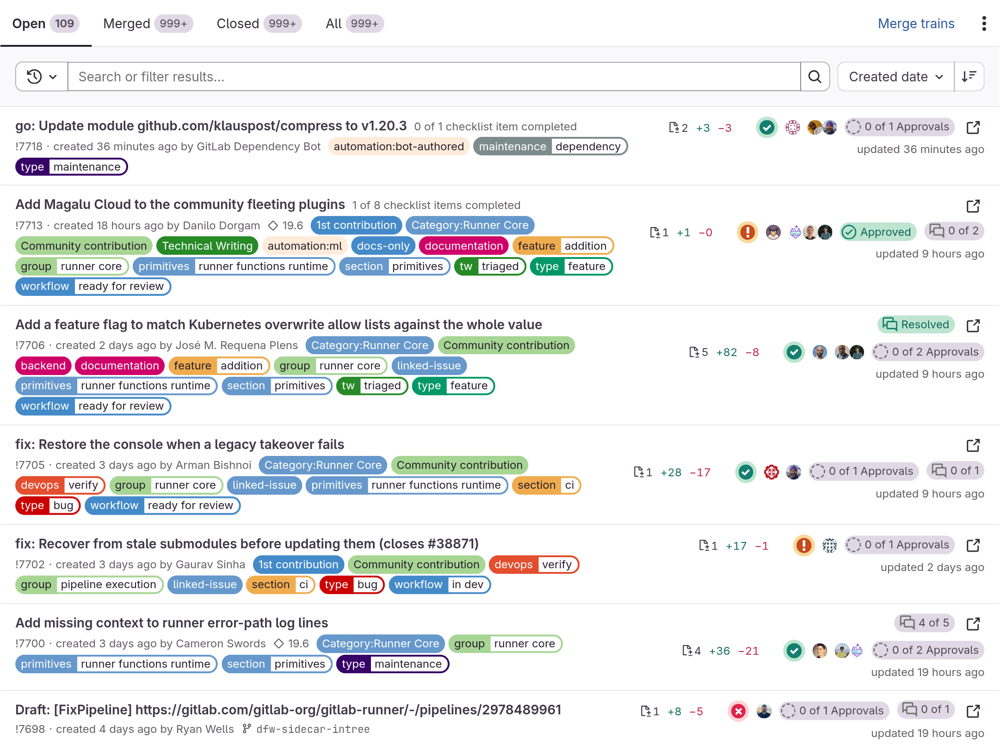
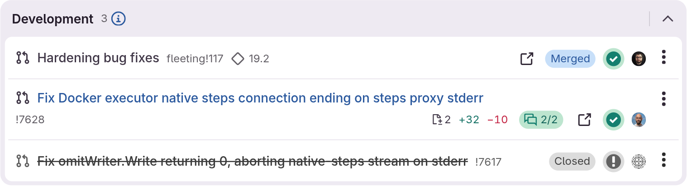

# GitLab booster

This adds long missing features to GitLab for code reviewers.

## Features

- **Merge request list**: changed files and added/deleted lines, unresolved threads (`x of y`, or resolved), and a button to preview the merge request in a modal
- **Issue detail**: the same diff and thread info on related open merge requests, with closed ones struck out and grayed
- **Issue board**: open/total related merge requests and iteration rollover count on each card
- **Merge request detail**: a "Convert to draft" button under reviewers

## Usage

### Install from greasyfork.org

https://greasyfork.org/en/scripts/509169-gitlab-booster

### Self-hosted GitLab instances

This is configurable in tampermonkey.

1. Click tampermonkey icons in the extension bar and open dashboard
2. Select gitlab booster and open Settings tab
3. Find Includes/Excludes section and Add your site in `User matches` like `https://self-host.com/*`

## Preview

Merge request list



Related merge requests on an issue



## Development

This project uses `bun`, `oxlint` and `oxfmt` for trying them out.

For local development, run

```shell
bun install
bun run dev
```

run `bun run lint && bun run format` for linting and formatting

## Credit

Thanks for the awesome work in this chrome extension https://github.com/Krystofee/gitlab-unresolved-threads, I adopted the unresolved threads to a user script and added other features.
